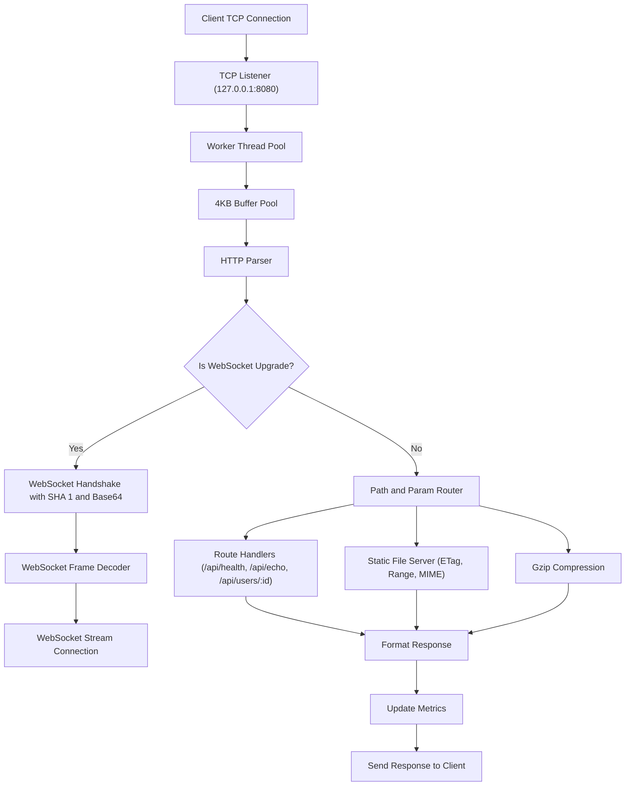

# HTTP Server

[](https://github.com/Rijzzz/http-server/actions/workflows/ci.yml)
[](https://github.com/Rijzzz/http-server/releases/latest)
[](https://www.rust-lang.org)
[](LICENSE)

A small, fast HTTP server written from scratch in Rust using only `std`.

I built this to understand how HTTP request parsing, connection keep alive, RFC 6455 WebSockets, and byte level frame masking work without relying on heavy frameworks like Tokio, Actix, or Hyper.

## Install

Install directly with cargo:

```bash
cargo install --git https://github.com/Rijzzz/http-server
```

Once installed, run the server from any terminal:

```bash
http-server
```

You can pass custom port and worker thread settings:

```bash
http-server --port 9000 --threads 16
```

To see all available CLI options:

```bash
http-server --help
```

## Quick Start

If you cloned the repository locally:

```bash
cargo run --release
```

To run on a custom port with custom worker threads:

```bash
cargo run --release -- --port 9000 --threads 16
```

Open `http://localhost:8080/` in your browser. The page lets you watch live server stats and test WebSocket messages in real time.

## Endpoints

| Method | Path | Content Type | Status | Description | Example Command |
| --- | --- | --- | --- | --- | --- |
| `GET` | `/` | `text/html; charset=utf-8` | 200 | Web dashboard and live WebSocket chat | Open in browser |
| `GET` | `/api/health` | `application/json` | 200 | Health check | `curl http://localhost:8080/api/health` |
| `POST` | `/api/echo` | `text/plain` | 200 | Echoes back whatever body you send | `curl -X POST -d "hello" http://localhost:8080/api/echo` |
| `GET` | `/api/users/:id` | `application/json` | 200 | Returns JSON with the id from the URL | `curl http://localhost:8080/api/users/42` |
| `GET` | `/compress` | `text/plain` | 200 | Sample response compressed with gzip | `curl --compressed http://localhost:8080/compress` |
| `GET` | `/metrics` | `application/json` | 200 | Current server stats in JSON | `curl http://localhost:8080/metrics` |
| `WS` | `/ws` | `RFC 6455 Frame` | 101 | Live two way WebSocket connection | Connect via browser or WS client |

## Library

You can also use this as a library in your own Rust applications:

```rust
use http_server::{Request, Response, Router, Server, StatusCode};
use std::collections::HashMap;

fn main() {
    let mut router = Router::new();

    router.get("/", |_req: &Request, _params: &HashMap<String, String>| {
        Response::text(StatusCode::Ok, "hello from rust!")
    });

    router.get("/api/users/:id", |_req: &Request, params: &HashMap<String, String>| {
        let id = params.get("id").cloned().unwrap_or_default();
        Response::json(StatusCode::Ok, &format!("{{\"user_id\":\"{id}\"}}"))
    });

    let server = Server::new(8, router);
    server.listen("127.0.0.1:8080").unwrap();
}
```

## Flow



## Internals

### WebSockets
When a browser connects with WebSockets, it sends a random challenge key in the headers. The server hashes that key with SHA 1, encodes it with Base64, and sends back an accept header. You can read how that works in `src/crypto.rs`. Once connected, `src/ws.rs` decodes and encodes incoming and outgoing frames, handling payload lengths up to 64 bit and applying 4 byte XOR masks for incoming client frames.

### Buffer Pool
Allocating new memory for every network read is wasteful. The server keeps a pool of reusable 4096 byte buffers in `src/page.rs`. When a worker thread needs to read from a socket, it grabs a buffer. When it finishes, Rust drops the page and puts it right back in the pool for the next request.

### Gzip
`src/gzip.rs` turns response text into gzip format with a CRC 32 checksum. This lets browsers receive compressed payloads when they ask for gzip.

### Stats
`src/stats.rs` uses thread safe atomic counters to keep track of active connections, total requests, bytes moved, and WebSocket messages.

## Tests

Run the automated test suite:

```bash
cargo test
```

Run the pedantic linter check:

```bash
cargo clippy --all-targets -- -D clippy::pedantic
```

Check code formatting:

```bash
cargo fmt --check
```

## Benchmarks

Run benchmarks locally:

```bash
cargo bench
```

Measured numbers from my benchmark run:

| Target | Iterations | Time | Throughput |
| --- | --- | --- | --- |
| HTTP Request Parsing | 100,000 | 165.49ms | 604,250 req/s |
| 4KB Page Buffer Recycling | 100,000 | 8.64ms | 11,570,324 ops/s |
| SHA 1 Hash | 100,000 | 74.77ms | 1,337,468 hashes/s |
| Base64 Encode | 100,000 | 12.91ms | 7,746,773 enc/s |
| WebSocket Frame Decoding | 100,000 | 9.43ms | 10,606,365 frames/s |
| Gzip Block Compression | 20,000 | 5.60ms | 3,568,497 blocks/s |

Benchmark numbers vary on different computers depending on CPU clock speed, cache size, and background apps.

## License

This project is licensed under the MIT License. See [LICENSE](LICENSE) for details.
